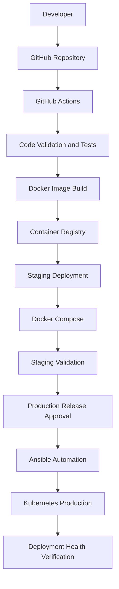
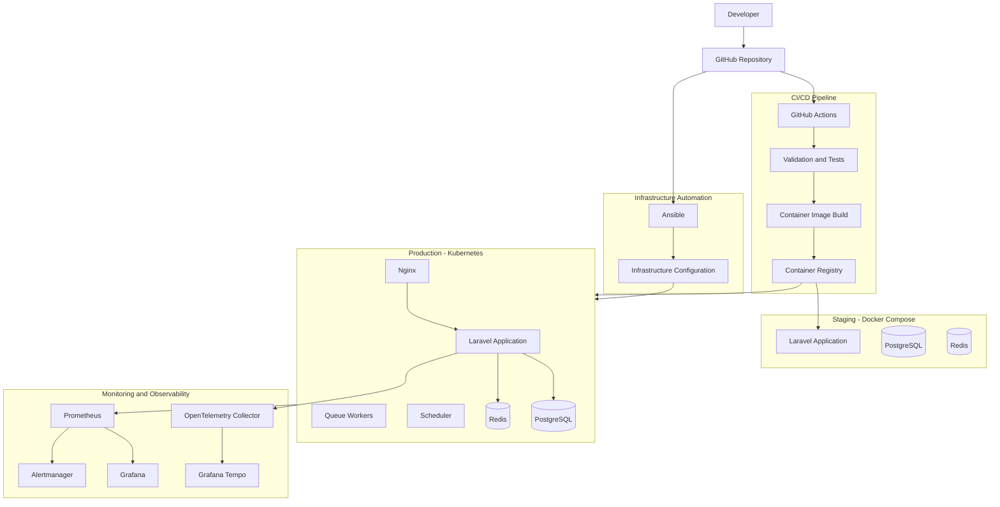

# MyLaravel

[](https://laravel.com/)
[](https://www.php.net/)
[](https://www.docker.com/)
[](https://kubernetes.io/)
[](https://www.ansible.com/)
[](https://github.com/features/actions)
[](https://prometheus.io/)
[](https://grafana.com/)

## Overview

MyLaravel is a Laravel application backed by a fully automated DevOps workflow, designed to manage two deployment environments — Staging and Production — using Docker Compose and Kubernetes.

The project integrates GitHub Actions, Docker, Ansible, and Kubernetes to automate application validation, container builds, infrastructure configuration, deployment, and operational monitoring. It provides a consistent path from code changes to production releases, with environment-specific deployment strategies and centralized observability.

The architecture separates pre-production validation from production operations:

- **Staging:** Docker Compose provides an isolated containerized environment for integration testing and release validation.
- **Production:** Kubernetes manages production application workloads, orchestration, availability, and deployment operations.
- **Automation:** Ansible manages infrastructure configuration and deployment operations.
- **CI/CD:** GitHub Actions coordinates the software delivery workflow.
- **Observability:** Prometheus, Grafana, Alertmanager, OpenTelemetry, and Grafana Tempo provide monitoring and telemetry capabilities.

The overall objective is to establish a consistent, repeatable, and version-controlled application delivery lifecycle.

---

## Table of Contents

- [Overview](#overview)
- [DevOps Architecture and Deployment Strategy](#devops-architecture-and-deployment-strategy)
- [Key Features](#key-features)
- [Architecture](#architecture)
- [Technology Stack](#technology-stack)
- [Application Architecture](#application-architecture)
- [Docker and Containerization](#docker-and-containerization)
- [Infrastructure Automation with Ansible](#infrastructure-automation-with-ansible)
- [Kubernetes Deployment](#kubernetes-deployment)
- [CI/CD Workflow](#cicd-workflow)
- [Monitoring and Observability](#monitoring-and-observability)
- [Repository Structure](#repository-structure)
- [Getting Started](#getting-started)
- [Docker Compose Environment](#docker-compose-environment)
- [Configuration and Secrets](#configuration-and-secrets)
- [Testing and Quality](#testing-and-quality)
- [Security Considerations](#security-considerations)
- [Operational Practices](#operational-practices)
- [Contributing](#contributing)
- [License](#license)

---

## DevOps Architecture and Deployment Strategy

MyLaravel follows a two-environment deployment strategy that separates pre-production validation from production operations.

| Environment | Deployment Platform | Purpose |
|---|---|---|
| Staging | Docker Compose | Integration testing, pre-production validation, and release verification |
| Production | Kubernetes | Production workloads, orchestration, availability, and scalable operations |

### Staging Environment — Docker Compose

The Staging environment provides a containerized platform for validating application changes before production release.

Docker Compose manages the application and its supporting services:

- Laravel / PHP-FPM
- Nginx
- PostgreSQL
- Redis
- Queue Workers
- Laravel Scheduler

This environment provides a controlled deployment target for integration testing, application validation, and release verification.

### Production Environment — Kubernetes

The Production environment uses Kubernetes to manage and orchestrate application workloads.

Kubernetes provides:

- Container workload management
- Service discovery and networking
- Rolling updates
- Workload recovery
- Resource management
- Persistent storage integration
- Health checks and availability

Ansible provides the infrastructure automation layer, managing the configuration and deployment operations required by the target environment.

### Automated Delivery Lifecycle

The project connects source control, CI/CD, containerization, infrastructure automation, and deployment platforms into a unified workflow.



The delivery lifecycle consists of the following stages:

1. **Source Control:** Application and infrastructure changes are maintained in GitHub.
2. **Continuous Integration:** GitHub Actions executes the configured validation, dependency, testing, and build jobs.
3. **Container Build:** Docker packages the application into deployable container images.
4. **Image Distribution:** Built images are published to the configured container registry.
5. **Staging Deployment:** The application is deployed to Staging using Docker Compose.
6. **Release Validation:** The Staging deployment is verified before production promotion.
7. **Production Deployment:** Ansible automates the required deployment operations and updates the Kubernetes environment.
8. **Post-Deployment Verification:** Application and infrastructure health are checked after deployment.

Production deployment is managed independently from Staging, with environment-specific configuration and controlled release procedures.

### Overall DevOps Objective

The intended delivery lifecycle is:

**Develop → Validate → Build → Deploy to Staging → Verify → Promote → Deploy to Production → Monitor**

---

## Key Features

### Application

- Laravel 12 application framework
- PHP 8.2+ runtime
- PostgreSQL database integration
- Redis integration
- Queue worker support
- Scheduled task execution
- Database migration support
- Frontend asset management with Vite

### Containerization

- Docker-based application runtime
- PHP-FPM application service
- Nginx web server
- PostgreSQL and Redis services
- Dedicated queue and scheduler services
- Persistent storage configuration
- Docker Compose environment

### Infrastructure and DevOps

- Infrastructure automation with Ansible
- Kubernetes deployment architecture
- Git-based configuration management
- GitHub Actions CI/CD integration
- Environment-specific deployment strategies
- Container-oriented deployment model
- Monitoring and observability integration

---

## Architecture

The project separates application development, infrastructure automation, deployment, and monitoring responsibilities.

### High-Level Architecture



*This diagram describes the project's architectural responsibilities and integration points. The exact execution sequence and deployment stages are defined by the repository's automation configurations.*

### Architectural Principles

1. **Version-controlled infrastructure:** Infrastructure configuration and automation are maintained in Git.
2. **Containerized runtime:** Application services run in predictable container environments.
3. **Automated operations:** Repetitive infrastructure and deployment tasks are handled through automation.
4. **Separation of concerns:** Application runtime, database, cache, background processing, and monitoring are separate services.
5. **Observability:** Metrics, telemetry, and dashboards provide operational visibility.

---

## Technology Stack

| Category | Technology |
|---|---|
| Backend Framework | Laravel 12 |
| Programming Language | PHP 8.2+ |
| Database | PostgreSQL 16 |
| Cache and Queue Backend | Redis 7 |
| Web Server | Nginx |
| PHP Runtime | PHP-FPM |
| Frontend Build | Vite |
| Container Runtime | Docker |
| Staging Deployment | Docker Compose |
| Production Orchestration | Kubernetes |
| Infrastructure Automation | Ansible |
| CI/CD | GitHub Actions |
| Metrics | Prometheus |
| Dashboards | Grafana |
| Alerting | Alertmanager |
| Telemetry | OpenTelemetry |
| Distributed Tracing | Grafana Tempo |
| Database Exporter | PostgreSQL Exporter |
| Redis Exporter | Redis Exporter |
| Host Metrics | Node Exporter |
| Container Metrics | cAdvisor |

---

## Application Architecture

The application is built on Laravel 12 and uses a service-oriented container layout.

### Main Application Services

| Service | Responsibility |
|---|---|
| Laravel Application | Handles application logic and HTTP requests |
| PHP-FPM | Executes PHP application code |
| Nginx | Handles HTTP traffic and forwards PHP requests |
| PostgreSQL | Persistent relational data storage |
| Redis | Cache and queue backend |
| Queue Worker | Processes asynchronous jobs |
| Scheduler | Executes scheduled Laravel tasks |

### Background Processing

Queue processing is separated from the main HTTP application.

The development Compose configuration includes a dedicated queue worker:

```bash
php artisan queue:work --sleep=3 --tries=3 --timeout=90
```

Scheduled Laravel tasks are handled by a separate scheduler service:

```bash
php artisan schedule:work
```

This separation allows background jobs and scheduled operations to run independently of incoming web requests.

---

## Docker and Containerization

Docker packages application runtime dependencies and provides a consistent environment across development and deployment.

### Docker Configuration

The repository includes:

- `Dockerfile`
- `docker-compose.dev.yml`
- `docker-compose.monitoring.yml`

### Container Services

| Container Service | Purpose |
|---|---|
| Application | Laravel PHP-FPM runtime |
| Nginx | HTTP server and reverse proxy |
| PostgreSQL | Relational database |
| Redis | Cache and queue backend |
| Queue Worker | Background job processing |
| Scheduler | Scheduled task execution |

### Persistent Data

Persistent storage is configured for important service data, including:

- PostgreSQL database files
- Redis persistence
- Private application files
- Backup data
- PostgreSQL WAL archive data

Persistent data should be stored outside the disposable container filesystem.

### Start the Development Environment

Configure the required environment variables and Docker images first.

The Compose configuration expects image variables similar to:

```dotenv
APP_IMAGE=your-application-image
NGINX_IMAGE=your-nginx-image
```

The external Docker network must exist:

```bash
docker network create myproject_backend
```

If it has already been created, do not create it again.

Start the services:

```bash
docker compose -f docker-compose.dev.yml up -d
```

Check service status:

```bash
docker compose -f docker-compose.dev.yml ps
```

View application logs:

```bash
docker compose -f docker-compose.dev.yml logs -f
```

Stop the environment:

```bash
docker compose -f docker-compose.dev.yml down
```

The `down` command does not remove named volumes unless volume removal is explicitly requested.

---

## Infrastructure Automation with Ansible

Ansible is used as the infrastructure automation layer.

Infrastructure-related automation is maintained under the `infra/` directory.

The objective is to manage infrastructure operations through version-controlled automation instead of relying on undocumented manual configuration.

### Responsibilities

Ansible can automate:

- Infrastructure preparation
- Host configuration
- Required package installation
- Runtime and system dependencies
- Kubernetes-related deployment operations
- Application deployment orchestration
- Configuration management
- Repeatable operational procedures

### Infrastructure as Code

The infrastructure automation approach follows these principles:

- Infrastructure configuration is stored in Git.
- Changes are reviewed before being applied.
- Automation should be repeatable and idempotent.
- Environment-specific configuration should be separated.
- Credentials and sensitive variables should not be committed to the repository.

### Deployment Relationship

| Component | Responsibility |
|---|---|
| Ansible | Infrastructure configuration and deployment automation |
| Kubernetes | Container workload orchestration |
| Docker | Container image building and packaging |
| GitHub Actions | CI/CD workflow execution |

Ansible is not a replacement for Kubernetes. It automates infrastructure and deployment tasks, while Kubernetes manages application workloads.

---

## Kubernetes Deployment

Kubernetes provides the orchestration layer for running containerized production workloads.

The repository includes infrastructure automation under `infra/`, which supports infrastructure-related deployment operations.

### Kubernetes Responsibilities

- Container workload management
- Desired-state reconciliation
- Service discovery
- Application scaling
- Workload recovery
- Rolling deployment capabilities
- Configuration and secret integration
- Persistent storage integration

### Deployment Architecture

The production deployment model separates application components into independently managed workloads.

| Workload | Responsibility |
|---|---|
| Web Application | Laravel application runtime |
| Nginx | HTTP traffic handling |
| Queue Worker | Asynchronous job processing |
| Scheduler | Scheduled application
