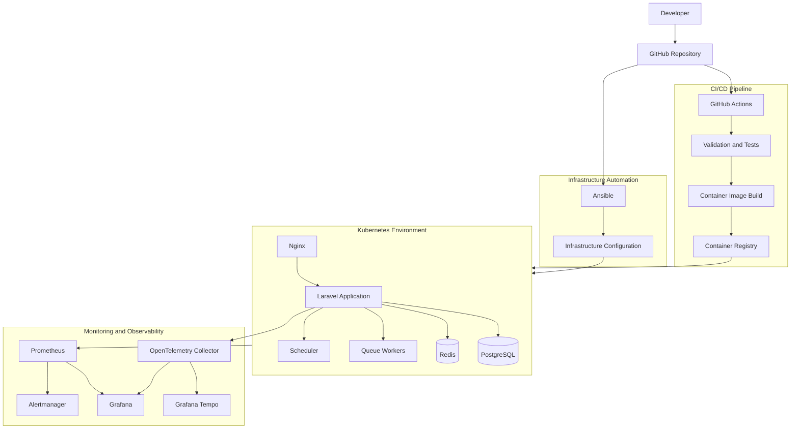
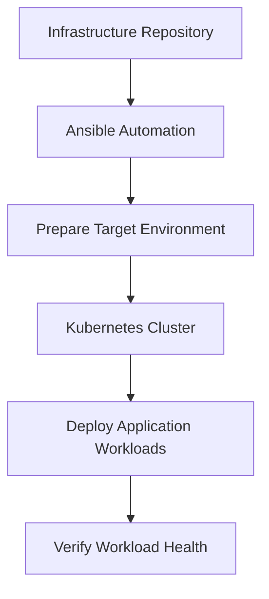
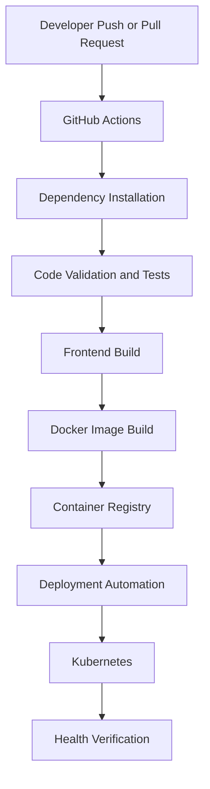
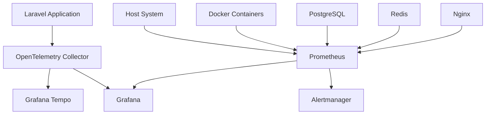

# MyLaravel

[](https://laravel.com/)
[](https://www.php.net/)
[](https://www.docker.com/)
[](https://kubernetes.io/)
[](https://www.ansible.com/)
[](https://github.com/features/actions)
[](https://prometheus.io/)
[](https://grafana.com/)

**A Laravel-based application with a containerized development environment and an infrastructure automation foundation for cloud-native deployment.**

---

## Table of Contents

- [Overview](#overview)
- [Key Features](#key-features)
- [Architecture](#architecture)
- [Technology Stack](#technology-stack)
- [Application Architecture](#application-architecture)
- [Docker and Containerization](#docker-and-containerization)
- [Infrastructure Automation with Ansible](#infrastructure-automation-with-ansible)
- [Kubernetes Deployment](#kubernetes-deployment)
- [CI/CD and DevOps Workflow](#cicd-and-devops-workflow)
- [Monitoring and Observability](#monitoring-and-observability)
- [Repository Structure](#repository-structure)
- [Getting Started](#getting-started)
- [Docker Compose Environment](#docker-compose-environment)
- [Configuration and Secrets](#configuration-and-secrets)
- [Testing and Quality](#testing-and-quality)
- [Security Considerations](#security-considerations)
- [Operational Practices](#operational-practices)
- [Contributing](#contributing)
- [License](#license)

---

## Overview

MyLaravel is a Laravel 12 application developed with a focus on maintainability, containerization, infrastructure automation, and operational visibility.

The repository brings application development and infrastructure operations together. It provides a Docker-based application environment, infrastructure automation through Ansible, Kubernetes deployment capabilities, CI/CD integration, and a monitoring and observability stack.

The project follows an automation-oriented approach:

- Application code is maintained in Git.
- Docker provides a consistent runtime environment.
- Ansible automates infrastructure provisioning and deployment operations.
- Kubernetes provides container orchestration.
- GitHub Actions provides the CI/CD automation foundation.
- Prometheus, Grafana, and OpenTelemetry provide monitoring and observability capabilities.

The goal is to keep application code, infrastructure configuration, and deployment automation version-controlled and maintainable.

## Key Features

### Application

- Laravel 12 application framework
- PHP 8.2+ runtime
- PostgreSQL database integration
- Redis integration
- Queue worker support
- Scheduled task execution
- Database migration support
- Frontend asset management with Vite

### Containerization

- Docker-based application runtime
- PHP-FPM application service
- Nginx web server
- PostgreSQL and Redis services
- Dedicated queue and scheduler services
- Persistent storage configuration
- Separate development and monitoring Compose configurations

### Infrastructure and DevOps

- Infrastructure automation with Ansible
- Kubernetes deployment architecture
- Git-based configuration management
- GitHub Actions CI/CD integration
- Container-oriented deployment model
- Monitoring and observability integration

---

## Architecture

The project separates application development, infrastructure automation, deployment, and monitoring responsibilities.

### High-Level Architecture



*This diagram describes the intended architectural responsibilities and integration points. The exact execution sequence and deployment stages are defined by the repository's actual automation configurations.*

### Architectural Principles

1. **Version-controlled infrastructure:** Infrastructure configuration and automation are maintained alongside application code.
2. **Containerized runtime:** Application services run in predictable container environments.
3. **Automated operations:** Repetitive infrastructure and deployment tasks are handled through automation.
4. **Separation of concerns:** Application runtime, database, cache, background processing, and monitoring are separate services.
5. **Observability:** Metrics, telemetry, and operational dashboards help identify problems and understand system behavior.

---

## Technology Stack

| Category | Technology |
|---|---|
| Backend Framework | Laravel 12 |
| Programming Language | PHP 8.2+ |
| Database | PostgreSQL 16 |
| Cache and Queue Backend | Redis 7 |
| Web Server | Nginx |
| PHP Runtime | PHP-FPM |
| Frontend Build | Vite |
| Container Runtime | Docker |
| Container Orchestration | Kubernetes |
| Infrastructure Automation | Ansible |
| CI/CD | GitHub Actions |
| Metrics | Prometheus |
| Dashboards | Grafana |
| Alerting | Alertmanager |
| Telemetry | OpenTelemetry |
| Distributed Tracing | Grafana Tempo |
| Database Exporter | PostgreSQL Exporter |
| Redis Exporter | Redis Exporter |
| Host Metrics | Node Exporter |
| Container Metrics | cAdvisor |

---

## Application Architecture

The application is built on Laravel 12 and uses a service-oriented container layout.

### Main Application Services

| Service | Responsibility |
|---|---|
| Laravel Application | Handles application logic and HTTP requests |
| PHP-FPM | Executes PHP application code |
| Nginx | Handles HTTP traffic and forwards PHP requests |
| PostgreSQL | Persistent relational data storage |
| Redis | Cache and queue backend |
| Queue Worker | Processes asynchronous jobs |
| Scheduler | Executes scheduled Laravel tasks |

### Background Processing

Queue processing is separated from the main HTTP application.

The development Compose configuration includes a dedicated queue worker:

```bash
php artisan queue:work --sleep=3 --tries=3 --timeout=90
```

Scheduled Laravel tasks are handled by a separate scheduler service:

```bash
php artisan schedule:work
```

This separation allows background jobs and scheduled operations to run independently of incoming web requests.

---

## Docker and Containerization

Docker is used to package application runtime dependencies and provide a consistent environment across development and deployment.

### Development Environment

The repository includes:

- `Dockerfile`
- `docker-compose.dev.yml`
- `docker-compose.monitoring.yml`

The development Compose configuration defines the application services and their dependencies.

### Container Services

| Container Service | Purpose |
|---|---|
| Application | Laravel PHP-FPM runtime |
| Nginx | HTTP server and reverse proxy |
| PostgreSQL | Relational database |
| Redis | Cache and queue backend |
| Queue Worker | Background job processing |
| Scheduler | Scheduled task execution |

### Persistent Data

Persistent storage is configured for important service data, including:

- PostgreSQL database files
- Redis persistence
- Private application files
- Backup data
- PostgreSQL WAL archive data

Persistent data should be stored outside the disposable container filesystem.

### Start the Development Environment

First, configure the required environment variables and Docker images.

The Compose configuration expects the following image variables:

```dotenv
APP_IMAGE=your-application-image
NGINX_IMAGE=your-nginx-image
```

The external Docker network must also exist:

```bash
docker network create myproject_backend
```

If it has already been created, do not create it again.

Start the services:

```bash
docker compose -f docker-compose.dev.yml up -d
```

Check service status:

```bash
docker compose -f docker-compose.dev.yml ps
```

View application logs:

```bash
docker compose -f docker-compose.dev.yml logs -f
```

Stop the environment:

```bash
docker compose -f docker-compose.dev.yml down
```

The `down` command does not remove named volumes unless volume removal is explicitly requested.

---

## Infrastructure Automation with Ansible

Ansible is used as the infrastructure automation layer.

Infrastructure-related automation is maintained under the `infra/` directory.

The objective is to manage infrastructure operations through version-controlled automation instead of relying on undocumented manual configuration.

### Responsibilities

Ansible can be used to automate:

- Infrastructure preparation
- Host configuration
- Required package installation
- Runtime and system dependencies
- Kubernetes-related deployment operations
- Application deployment orchestration
- Configuration management
- Repeatable operational procedures

### Infrastructure as Code

The infrastructure automation approach follows these principles:

- Infrastructure configuration is stored in Git.
- Changes are reviewed before being applied.
- Automation should be repeatable and idempotent.
- Environment-specific configuration should be separated.
- Credentials and sensitive variables should not be committed to the repository.

### Deployment Relationship

Ansible and Kubernetes have different responsibilities:

| Component | Responsibility |
|---|---|
| Ansible | Automates infrastructure configuration and deployment operations |
| Kubernetes | Runs and manages containerized workloads |
| Docker | Builds and packages application containers |
| GitHub Actions | Automates CI/CD pipeline execution |

Ansible is not a replacement for Kubernetes. It automates infrastructure and deployment tasks, while Kubernetes manages the application workloads after deployment.

---

## Kubernetes Deployment

Kubernetes provides the orchestration layer for running containerized application workloads.

The repository includes infrastructure automation under `infra/`, which is used as the source of truth for infrastructure-related deployment operations.

### Kubernetes Responsibilities

Kubernetes provides:

- Container workload management
- Desired-state reconciliation
- Service discovery
- Application scaling
- Workload recovery
- Rolling deployment capabilities
- Configuration and secret integration
- Persistent storage integration

### Deployment Architecture

The deployment model separates application components into independently managed workloads.

Typical application components include:

| Workload | Responsibility |
|---|---|
| Web Application | Laravel application runtime |
| Nginx | HTTP traffic handling |
| Queue Worker | Asynchronous job processing |
| Scheduler | Scheduled application tasks |
| PostgreSQL | Persistent relational database |
| Redis | Cache and queue backend |

The exact Kubernetes resource definitions and deployment commands should be taken from the manifests, Helm charts, and Ansible automation maintained in `infra/`.

### Deployment Flow



### Deployment Principles

- Infrastructure configuration is version-controlled.
- Deployment operations should be repeatable.
- Application workloads should use versioned container images.
- Persistent data must be managed separately from ephemeral workloads.
- Application health should be verified after deployment.
- Production secrets must be supplied securely.

---

## CI/CD and DevOps Workflow

Continuous Integration and Continuous Delivery are important parts of the project's development and deployment approach.

GitHub Actions is used as the CI/CD automation platform.

The objective is to reduce manual intervention and provide a consistent process for validating, packaging, and deploying application changes.

### Continuous Integration (CI)

The CI stage is responsible for validating application changes.

Typical validation activities include:

1. Checking out the source code.
2. Installing application dependencies.
3. Validating Composer dependencies.
4. Running automated tests.
5. Building frontend assets.
6. Building container images when configured.
7. Publishing build results and artifacts.

### Continuous Delivery / Deployment (CD)

The deployment stage connects validated application builds with the target infrastructure.

A typical deployment lifecycle includes:

1. A change is pushed to the Git repository.
2. GitHub Actions starts the configured workflow.
3. The application is validated and tested.
4. A container image is built.
5. The image is published to a container registry.
6. Infrastructure automation is executed where required.
7. Kubernetes workloads are updated.
8. Deployment health is verified.

### CI/CD Architecture



*The diagram represents the CI/CD architecture. Actual triggers, jobs, registry configuration, deployment targets, and approval requirements are defined by the workflow files in `.github/workflows/`.*

### DevOps Responsibilities

| Area | Responsibility |
|---|---|
| Source Control | Git and GitHub |
| Continuous Integration | GitHub Actions |
| Containerization | Docker |
| Image Distribution | Container Registry |
| Infrastructure Automation | Ansible |
| Orchestration | Kubernetes |
| Monitoring | Prometheus |
| Visualization | Grafana |
| Alerting | Alertmanager |
| Telemetry | OpenTelemetry |

### Deployment Best Practices

- Build immutable, versioned container images.
- Avoid deploying unverified images.
- Keep secrets outside source control.
- Use health checks to validate deployed services.
- Keep deployment configuration under version control.
- Separate development and production configuration.
- Use controlled deployment procedures for production environments.

---

## Monitoring and Observability

The project includes a dedicated monitoring configuration through:

```text
docker-compose.monitoring.yml
```

The monitoring stack provides infrastructure metrics, application telemetry, dashboards, alerting, and distributed tracing components.

### Monitoring Stack

| Component | Version | Responsibility |
|---|---:|---|
| Prometheus | 3.5.0 | Metrics collection and storage |
| Grafana | 12.1.1 | Dashboards and visualization |
| Alertmanager | 0.28.1 | Alert management |
| Node Exporter | 1.9.1 | Host-level metrics |
| cAdvisor | 0.55.1 | Container metrics |
| PostgreSQL Exporter | 0.17.1 | PostgreSQL metrics |
| Redis Exporter | 1.76.0 | Redis metrics |
| Nginx Prometheus Exporter | 1.5.1 | Nginx metrics |
| OpenTelemetry Collector Contrib | 0.138.0 | Telemetry collection and processing |
| Grafana Tempo | 3.0.3 | Distributed trace storage |

### Prometheus

Prometheus is responsible for collecting and storing time-series metrics.

The configured monitoring stack uses a 15-day retention period.

Metrics can be collected from:

- Host operating systems
- Docker containers
- PostgreSQL
- Redis
- Nginx
- Application instrumentation

### Grafana

Grafana provides a centralized interface for dashboards and monitoring visualization.

It can be used to inspect:

- Infrastructure health
- CPU and memory utilization
- Container resource usage
- Database metrics
- Redis metrics
- Application performance
- Telemetry data

### Alertmanager

Alertmanager handles alert notifications and alert grouping based on configured Prometheus alerting rules.

### OpenTelemetry

OpenTelemetry provides a vendor-neutral approach to collecting and processing telemetry.

The project includes OpenTelemetry-related PHP dependencies and an OpenTelemetry Collector configuration.

The telemetry pipeline can be used to collect and forward application telemetry to supported observability backends.

### Grafana Tempo

Grafana Tempo is included as the distributed tracing backend.

It provides a foundation for analyzing request execution paths and identifying performance bottlenecks across application components.

### Monitoring Architecture



### Start Monitoring Services

Prepare the monitoring environment variables and required configuration files, then run:

```bash
docker compose -f docker-compose.monitoring.yml up -d
```

Check service status:

```bash
docker compose -f docker-compose.monitoring.yml ps
```

View monitoring logs:

```bash
docker compose -f docker-compose.monitoring.yml logs -f
```

Monitoring services use the external Docker network `myproject_backend`.

---

## Repository Structure

The repository is organized to keep application code, infrastructure automation, deployment configuration, and operational tooling separated.

```text
MyLaravel/
│
├── .github/
│   └── workflows/
│
├── app/
│
├── bootstrap/
│
├── config/
│
├── database/
│
├── docker/
│   └── monitoring/
│
├── infra/
│
├── public/
│
├── resources/
│
├── routes/
│
├── scripts/
│
├── storage/
│
├── tests/
│
├── Dockerfile
├── docker-compose.dev.yml
├── docker-compose.monitoring.yml
├── composer.json
├── composer.lock
├── package.json
├── package-lock.json
├── phpunit.xml
└── README.md
```

### Directory Responsibilities

| Directory | Purpose |
|---|---|
| `.github/workflows/` | GitHub Actions workflow definitions |
| `app/` | Laravel application logic |
| `bootstrap/` | Laravel application bootstrap |
| `config/` | Application configuration |
| `database/` | Migrations, seeders, and factories |
| `docker/` | Docker-related configuration and monitoring files |
| `infra/` | Infrastructure automation and deployment configuration |
| `public/` | Public web entry point and assets |
| `resources/` | Frontend and application resources |
| `routes/` | Application route definitions |
| `scripts/` | Operational and utility scripts |
| `storage/` | Application-generated files and logs |
| `tests/` | Automated application tests |

---

## Getting Started

### Prerequisites

Before starting development, ensure the following tools are available:

- Git
- PHP 8.2 or newer
- Composer
- Node.js and npm
- PostgreSQL 16
- Redis 7
- Docker Engine
- Docker Compose

For infrastructure deployment, additional requirements may include:

- Ansible
- Access to the target infrastructure
- Kubernetes access and credentials
- Access to the configured container registry

### Clone the Repository

```bash
git clone https://github.com/Kamalidariush/MyLaravel.git

cd MyLaravel
```

### Install PHP Dependencies

```bash
composer install
```

### Install Frontend Dependencies

```bash
npm ci
```

### Configure Environment

```bash
cp .env.example .env
```

Update the environment variables according to your local environment.

### Generate Application Key

```bash
php artisan key:generate
```

### Run Database Migrations

Make sure PostgreSQL is configured and accessible.

```bash
php artisan migrate
```

### Build Frontend Assets

```bash
npm run build
```

### Start Laravel Development Server

```bash
php artisan serve
```

The application will be available at:

```text
http://127.0.0.1:8000
```

---

## Docker Compose Environment

For a containerized development environment, configure the required environment variables and Docker images first.

Create the external network if it does not already exist:

```bash
docker network create myproject_backend
```

Start the application stack:

```bash
docker compose -f docker-compose.dev.yml up -d
```

Inspect running containers:

```bash
docker compose -f docker-compose.dev.yml ps
```

Follow application logs:

```bash
docker compose -f docker-compose.dev.yml logs -f
```

Stop the application stack:

```bash
docker compose -f docker-compose.dev.yml down
```

The Docker Compose configuration separates web traffic handling, PHP execution, database services, cache services, and background processing.

---

## Configuration and Secrets

Application configuration is managed through environment variables.

The `.env.example` file provides a template for local configuration.

Important configuration areas include:

| Variable Group | Purpose |
|---|---|
| Application | Application name, URL, environment, and debug mode |
| Database | PostgreSQL connection settings |
| Redis | Cache and queue connection settings |
| Mail | Email transport configuration |
| Storage | File storage configuration |
| Logging | Application logging configuration |
| OpenTelemetry | Telemetry and tracing configuration |
| Docker | Container image and service configuration |

### Secret Management

Sensitive values must never be committed to Git.

Examples include:

- Database passwords
- API keys
- Application secrets
- Registry credentials
- SSH private keys
- Kubernetes credentials
- SMTP credentials

Use secure environment variables, GitHub Actions secrets, or an appropriate secret-management system.

---

## Testing and Quality

The project uses Laravel's testing infrastructure.

Run the automated test suite:

```bash
php artisan test
```

Or use the Composer test script:

```bash
composer run test
```

Additional quality checks may be integrated into GitHub Actions as part of the continuous integration process.

Testing should be performed before deploying changes to production environments.

---

## Security Considerations

Security is considered across application development, containerization, infrastructure automation, and deployment.

Recommended practices include:

- Keep application secrets outside Git.
- Never commit private SSH keys.
- Use least-privilege access for infrastructure automation.
- Restrict database exposure to trusted networks.
- Use secure authentication for deployment systems.
- Keep container images and operating system packages updated.
- Avoid exposing internal monitoring endpoints publicly.
- Use TLS for externally accessible services.
- Review infrastructure changes before applying them.
- Regularly inspect dependencies for known vulnerabilities.
- Protect persistent data with appropriate backup and access policies.

### Public Repository Checklist

Before publishing or maintaining this repository as public, verify:

- No `.env` files or real credentials are tracked.
- No private SSH keys or access tokens exist in Git history.
- No production database dumps or sensitive backups are committed.
- No confidential infrastructure inventories or private addresses are exposed unintentionally.
- GitHub Actions secrets are configured outside the repository.
- Sensitive files are covered by `.gitignore`.

---

## Operational Practices

For a reliable deployment and maintenance process, the following practices are recommended.

### Application Lifecycle

- Keep application code in Git.
- Use dependency lock files for reproducible builds.
- Run tests before releasing changes.
- Build and tag container images consistently.
- Keep development and production configurations separate.

### Infrastructure Lifecycle

- Maintain infrastructure configuration in version control.
- Apply infrastructure changes through reviewed automation.
- Keep Ansible operations repeatable and idempotent.
- Avoid undocumented manual changes to production systems.
- Validate infrastructure changes before deployment.

### Kubernetes Operations

- Use declarative workload configuration.
- Keep application images versioned.
- Define suitable resource requests and limits.
- Configure readiness and liveness probes where appropriate.
- Monitor workload health and persistent storage.
- Plan database backup and recovery procedures.

### Monitoring and Recovery

- Monitor application and infrastructure health.
- Review alerting rules and notification channels.
- Retain backups according to operational requirements.
- Test recovery procedures periodically.
- Investigate application errors using logs, metrics, and traces.

---

## Contributing

Contributions are welcome.

A typical contribution process:

1. Fork the repository.
2. Create a feature branch.
3. Implement your changes.
4. Run relevant tests.
5. Commit your changes with a meaningful message.
6. Open a Pull Request.

Example:

```bash
git checkout -b feature/your-feature
```

Keep changes focused, maintain existing project conventions, and include tests where appropriate.

---

## License

The `composer.json` file declares the project license as MIT.

Refer to the repository's `LICENSE` file for the complete license terms.

---

## Maintainer

**Dariush Kamali**

GitHub: [@Kamalidariush](https://github.com/Kamalidariush)

---

<p align="center">
  Built with Laravel, Docker, Ansible, Kubernetes, and open-source technologies.
</p>
